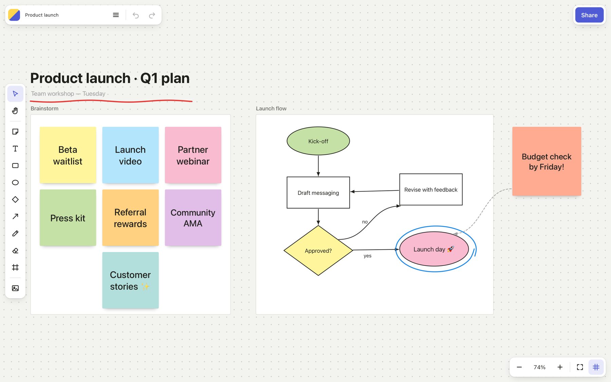
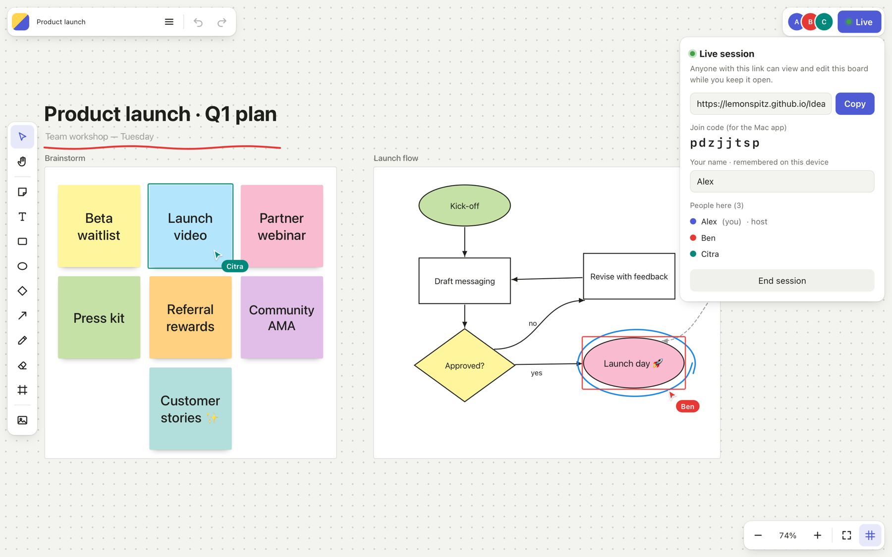

# Idea Board

An infinite-canvas whiteboard for macOS and the web, in the spirit of Miro: sticky notes, shapes,
text, connectors, freehand pen, frames, images and templates, with **live collaboration**.

## Get it

- **Mac app:** download **Idea-Board-Mac.zip** from the [latest release](https://github.com/lemonspitz/IdeaBoard/releases/latest),
  unzip it and drag **Idea Board** into Applications. Needs macOS 13 or later (Apple silicon and Intel).
  The app isn't notarised by Apple, so the first time, right-click it and choose **Open**
  (or go to System Settings → Privacy & Security → **Open Anyway**).
- **Browser (any computer or phone):** https://lemonspitz.github.io/IdeaBoard/ — nothing to install.

You create a free account the first time (name, email, password) and confirm your email address.

## Work together live

Click **Share → Start live session** and send the link. Anyone who opens it edits the same board
in real time and sees everyone's cursors, names and selections. Mac app users can also paste the
link or join code into **Share → Join**, or open `ideaboard://join/CODE`.

- **No name to type.** Each device remembers its name: the Mac app uses your account's first name,
  browsers get a friendly name like "Teal Otter". Change it any time in the Share panel, even mid-session.
  Devices are recognised by a random ID made on first use (never a hardware ID), so returning
  collaborators keep their colour.
- **Undo only undoes your own changes**, never someone else's.
- **Peer-to-peer.** The board travels directly between computers over WebRTC. The free public
  PeerJS broker only introduces them and never sees the board.
- The host's board is the hub, so the session lasts while the host keeps it open (the Mac app keeps
  running in the background or minimised). When it ends, everyone keeps a copy.
- Very strict company or school networks can block peer-to-peer connections.

## Accounts and cloud boards

Sign up with your email and a password, confirm the email, and your boards are saved to your
account. Open them from any Mac or browser under **My boards**, and invite people by email from
**Share**. Everyone with access sees changes and cursors live, even when the owner is offline.
Invited boards show up under **Shared with me**. Accounts and boards are stored in Firebase
(Singapore region); see [FIREBASE-SETUP.md](FIREBASE-SETUP.md) for how the project is set up.

## Features

- Sticky notes (text shrinks to fit), rectangles, ellipses, diamonds, text, frames, images, pen and eraser
- Connectors that stay attached to shapes: straight or curved, dashed, arrowheads, colours, widths
- Frames carry their contents when moved; templates for Kanban, Retrospective, Mind map, Flowchart, SWOT and Brainstorm
- Multi-select, resize, duplicate (⌘D or ⌥-drag), layering, copy/paste including images and lists of text
- Save as `.ideaboard`, export to PNG, automatic saving, light and dark themes

## Shortcuts

| Key | Tool / action | Key | Tool / action |
|---|---|---|---|
| V | Select | H / Space-drag | Pan |
| N | Sticky note | T | Text |
| R / O / D | Rectangle / ellipse / diamond | L | Connector |
| P | Pen | E | Eraser |
| F | Frame | I | Image |
| ⌘Z / ⇧⌘Z | Undo / redo | ⌘D, ⌥-drag | Duplicate |
| ⌘C / ⌘X / ⌘V | Copy / cut / paste | ⌫ | Delete |
| ] / [ | Front / back | Enter | Edit text |
| ⌘+ / ⌘− / ⌘0 / ⇧1 | Zoom in / out / 100% / fit | G | Grid |
| ⇧⌘L | Work together live (Mac) | | |

Double-click empty space for a sticky note. Pasting several lines of text makes one sticky per line.

## Build from source

    ./build.sh            # build/Idea Board.app (universal, macOS 13+)
    ./build.sh --install  # also copy to /Applications

The whiteboard engine is one file, `Resources/web/index.html` (also published from `docs/` to
GitHub Pages). `Sources/main.swift` wraps it in a native window with menus, open/save panels,
PNG export, join links and autosave to `~/Library/Application Support/Idea Board`.

Checks: `--selftest` (template + PNG export), `--selftest-join CODE` (joins a live session),
`--shot board.ideaboard out.png [--host]` (the README screenshots; demo board in `tools/`).

MIT · @lemonspitz
